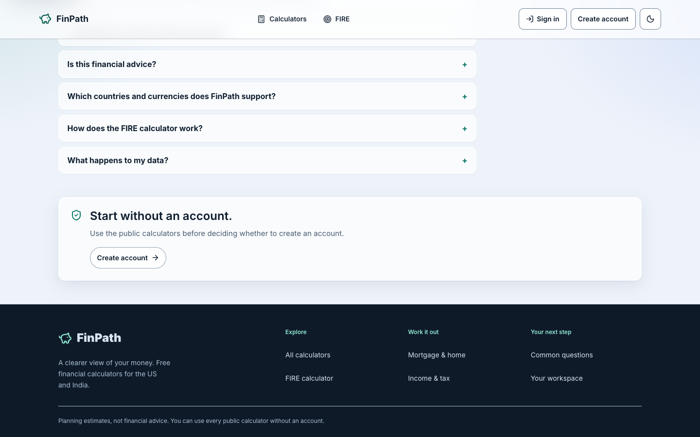

# B70 — Luminous Observatory shell, 2026-10-28

The foundation keeps the accepted page layouts and solid financial values. Navigation gets measured teal/navy ink, clearer selected state,44px targets and an80/72px sticky header; a shared solid footer makes public destinations available across routes. Inter remains the UI and numeric face. Home, calculator, chart and workspace redesigns are later checkpoints.

| Before B68:390px dark | B70:390px dark |
|---|---|
|  |  |

[Actual OKLCH conversions](oklch-tokens.json), [rendered contrast](contrast.json), [viewport/navigation checks](local-browser.json), [preference/reflow checks](preferences.json), [bundle comparison](asset-comparison.json), [source and tests](local-verification.json), [raw provenance](manifest.json). Screenshots show home/shell; there is no claim that the rest of the visual redesign shipped.

The historical22-route invisible-eyebrow claim was not reproduced. Baseline gradient-clipped glyphs were visible. The new solid eyebrows were measured on92routes per theme,317samples each; minimum5.64:1 light and7.54:1 dark. Final shell text and active-boundary samples pass their targets. These are sampled checks; native accessibility gates remain open.

C31 candidate09de7c48 and shared beta9a8e7915 are verified at product2aec033. Hosted performance, browser/API/CSV checks and limits are in the C31 review. The PR156 landing receipt is the authority for repository landing; resolve it before starting another checkpoint. After images are from the accepted shared beta; before is the preserved B68 baseline.
