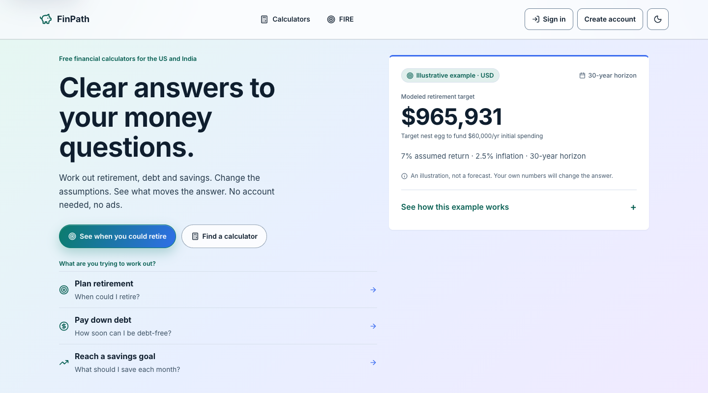
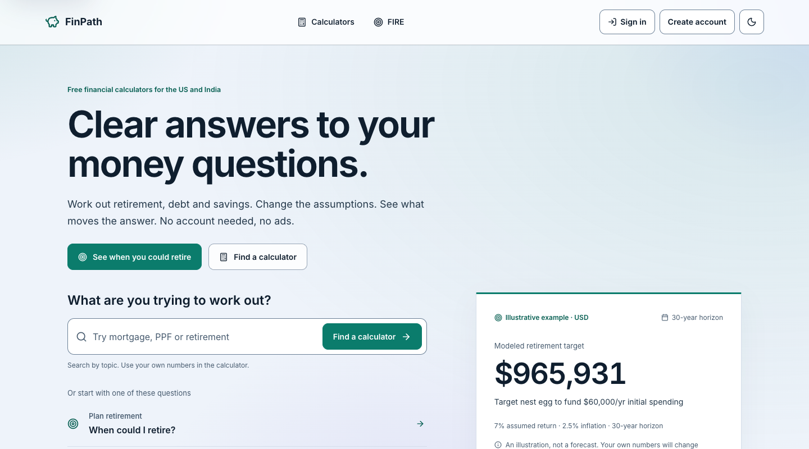

# Homepage — Luminous Observatory (B78/C38)

Accepted 2026-10-29. [Live shared beta](https://codex-finpath-quality-execut.interactive-fire-calculator.pages.dev/), [candidate](https://71aa3a01.interactive-fire-calculator.pages.dev/), [PR #157](https://github.com/rakeshnreddy/Interactive-FIRE-Calculator/pull/157). Source `27e2ece8d4a664e4f43fe27a3c407b0fefae6ab4`. The complete width/theme matrices and provenance are in [manifest](manifest.json).

The open introduction leads to a working topic finder and three ruled public decision paths. One opaque FIRE illustration keeps real engine-backed numbers readable; assumptions and its chart open on request. Numbered explanation and product principles replace nested cards. Inter and B70’s teal/navy palette remain; homepage layout is owned by home.css. Search reuses existing library query URLs, with no added dependency or second search engine.

## Before and after — 1440×800, light

Before: accepted B70, immutable 9a8e7915.

After: B78 candidate, identical runtime bytes on the verified shared beta.

## Mobile — 320×900, dark

All three selected PNGs are under 300,000 bytes. Desktop after-image uses lossless IDAT recompression only; original dimensions/scanline bytes are preserved. Full 1440/768/390/320×900 captures, disclosures, print and footer views remain ignored with hashes.

The finder, native FAQ and example disclosure work by keyboard; primary action fits the first viewport. [Browser evidence](browser.json), [preferences](preferences.json), [contrast](contrast.json), [performance](performance.json). Real text samples have minimum ratios of 5.10 (light) and 7.44 (dark). Both deployments pass 24 preference cases with fresh explicit media settings. No whole-site conformance claim.

Nine paired cold loads per release/route/width retain all 72 observations. Home median LCP 312 → 288ms desktop and 268 → 248ms mobile; library 376 → 404ms desktop and 404 → 380ms mobile. Home CLS: desktop 0.00593 → 0.0000196, mobile 0.02489 → 0.03004; library CLS 0. These are variable unthrottled lab measurements, not field metrics or an across-board speed claim. Total runtime payload falls 2,883 gzip bytes (JS +313 / CSS −3,196). The small mobile initial-shift increase is disclosed.
